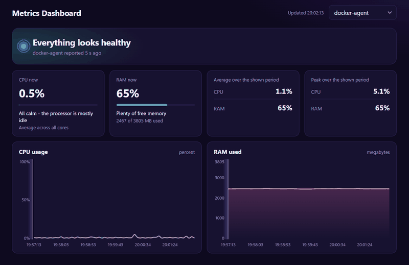

<h1 align="center">Metrics Service</h1>

<p align="center"><b>Measure the host. Send it over HTTP. Query it back</b></p>

<p align="center">
A tiny self-hosted metrics pipeline written in C++. An agent reads CPU and RAM usage straight from <code>/proc</code>, ships it as JSON to a small HTTP API, and the API keeps everything in MySQL, ready to be queried by host and time range. The whole stack starts with a single <code>docker compose up</code>.
</p>

<p align="center">
  
  
  
  
  
  
</p>

<p align="center">
  
</p>

## Features

- Collects CPU usage (in percent) and memory usage (used / total, MB) every N seconds
- Accepts measurements over HTTP (`POST /ingest`) with input validation
- Stores data in MySQL 8, indexed by host and time
- Queries measurements by host and time range
- Web dashboard at `http://localhost:8080/` with a chart per host
- Unit tests for `/proc` parsing and CPU usage calculation, run in GitHub Actions

## Architecture

```
+---------+   POST /ingest   +---------+     SQL     +---------+
|  agent  | ---------------> |   api   | ----------> |  MySQL  |
| (C++)   |      (JSON)      | (C++)   |             |    8    |
+---------+                  +---------+             +---------+
 reads /proc                  GET /hosts
                              GET /metrics
                              GET /  (dashboard)
```

- **agent** reads `/proc/stat` and `/proc/meminfo` and sends the values to the API.
- **api** validates the data, stores it in MySQL, serves it back, and hosts the dashboard from the `web/` folder.
- **mysql** keeps two tables: `hosts` (host names) and `metrics` (measurements).

## Tech stack

C++17, CMake, cpp-httplib, nlohmann/json, MySQL Client Library, MySQL 8, Docker Compose, GoogleTest, GitHub Actions.

## Quick start

Requires Docker and Docker Compose.

```bash
git clone https://github.com/Maksimuson/Metrics-Service.git
cd Metrics-Service
cp .env.example .env      # then set your own passwords in .env
docker compose up -d --build
```

After a few seconds the agent starts sending metrics:

```bash
docker compose logs -f agent
curl "localhost:8080/metrics?host=docker-agent&limit=3"
```

Open the dashboard in your browser: <http://localhost:8080/>

Stop everything with `docker compose down`. Add `-v` to also delete the stored data.

## Configuration

All settings come from environment variables. The template is in `.env.example`.

| Variable | Used by | Default | Description |
|----------|---------|---------|-------------|
| `DB_HOST` | api | `127.0.0.1` | MySQL host |
| `DB_PORT` | api | `3306` | MySQL port |
| `DB_USER` | api | `app` | MySQL user |
| `DB_PASS` | api | none (required) | MySQL password |
| `DB_NAME` | api | `metrics` | Database name |
| `PORT` | api | `8080` | HTTP API port |
| `API_HOST` | agent | `127.0.0.1` | API address |
| `API_PORT` | agent | `8080` | API port |
| `INTERVAL_SEC` | agent | `5` | Sending interval, in seconds |
| `HOST_NAME` | agent | system host name | Host name the metrics are stored under |

`docker-compose.yml` also uses `DB_ROOT_PASS` and `DB_PORT` (the MySQL port on the host machine).

## API

| Method | Path | Description |
|--------|------|-------------|
| GET | `/health` | Health check, returns `ok` |
| POST | `/ingest` | Store one measurement |
| GET | `/hosts` | List of host names |
| GET | `/metrics` | Measurements of one host, newest first |
| GET | `/` | Web dashboard |

### POST /ingest

```bash
curl -X POST localhost:8080/ingest \
  -H "Content-Type: application/json" \
  -d '{"host":"srv1","cpu_percent":12.5,"ram_used_mb":2048,"ram_total_mb":8192}'
```

Responses:

- `201`: measurement saved (`{"status":"saved"}`)
- `400`: invalid JSON, a missing field or wrong type, or values out of range: `cpu_percent` must be between 0 and 100, `ram_used_mb` must not exceed `ram_total_mb`, host name must be 1 to 255 characters
- `500`: database error

### GET /metrics

| Parameter | Required | Description |
|-----------|----------|-------------|
| `host` | yes | Host name |
| `from`, `to` | no | Time range in the format `2026-10-04 10:00:00` (UTC) |
| `limit` | no | Maximum rows: default 100, maximum 1000 |

Example response:

```json
[
  {"ts": "2026-10-04 10:00:05", "cpu_percent": 12.5, "ram_used_mb": 2048, "ram_total_mb": 8192}
]
```

## Local development without Docker

Requires Linux. Dependencies on Ubuntu/Debian:

```bash
sudo apt install build-essential cmake libcpp-httplib-dev \
  nlohmann-json3-dev libmysqlclient-dev libgtest-dev
```

Build:

```bash
cmake -S api -B api/build && cmake --build api/build
cmake -S agent -B agent/build -DBUILD_TESTS=ON && cmake --build agent/build
```

Running the API needs environment variables with access to MySQL. For example, if `.env` is in the project root:

```bash
cd api
set -a; source ../.env; set +a
./build/api
```

Run the tests:

```bash
./agent/build/test_collector
```

The tests cover parsing of `/proc/stat` and `/proc/meminfo` and the CPU usage calculation.

## Project structure

```
metrics-service/
├── agent/                 C++ agent: metrics collection and sending
│   ├── src/               collector, sender, config, main
│   ├── tests/             unit tests (GoogleTest)
│   ├── CMakeLists.txt
│   └── Dockerfile
├── api/                   C++ HTTP API
│   ├── src/               routes (main), MySQL access (db), config
│   ├── web/               web dashboard (index.html, chart.umd.js)
│   ├── CMakeLists.txt
│   └── Dockerfile
├── docs/
│   ├── dashboard.gif      dashboard animation for the README
│   └── dashboard.png      original screenshot
├── db/
│   ├── init.sql           database schema (created on the first MySQL start)
│   └── playground.sql     sample queries for manual checks
├── .github/workflows/ci.yml   build and tests on push and pull request
├── docker-compose.yml
└── .env.example
```

## Limitations

- The `/ingest` endpoint has no authentication, so the service is meant for an internal network. Add token checks or close the port before exposing it.
- The agent measures the system it runs in. Inside a Docker container this is the Docker VM (WSL or the Linux VM), not the physical host.
- The API sets timestamps when data is received, and they are stored in UTC.
- Each request opens a new MySQL connection. This is fine for a learning project, but under load a connection pool should be added.

## Possible improvements

- Authentication for `/ingest` (API key or token)
- MySQL connection pool
- More metrics: disk, network, per-process load
- Scheduled cleanup of old data (retention)